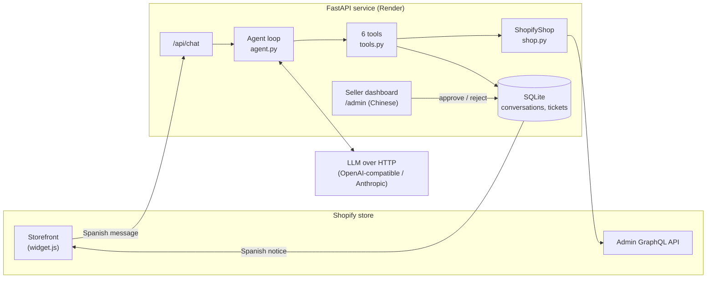

# Spanish customer-service agent for Shopify

[中文说明](README.zh-CN.md)

An AI support agent for Chinese sellers on Shopify who sell to Spanish-speaking customers in Spain and Latin America. Shoppers chat in Spanish (any variety, or mixed with English). The agent answers from **live store data**: products, sizes, stock, shipping, policies and order status. It never refunds or cancels on its own. Those requests become tickets that the seller approves in a **Chinese-language dashboard**, and the shopper gets a Spanish notification.

Everything is hand-written: no LangChain or other agent framework, no vendor SDKs. Models are called over plain HTTP with `httpx`, through a small adapter that speaks both the OpenAI-compatible and Anthropic APIs, so the model can be swapped by changing config.

> **Demo video:** _coming soon_

## Results

Evaluated on a real Shopify development store with 32 hand-written cases covering es-ES, es-MX, es-CO, es-AR, Spanglish, an English shopper, and 3 prompt-injection or off-topic attacks. Each case is scored with rule checks (required tool calls, required and forbidden phrases, reply in Spanish) plus an LLM judge for grounding and register. Model: DeepSeek V4.1 Flash.

| Stage | Pass rate |
|---|---|
| First run, mock data, rules only | 26/32 (81%) |
| After fixes, mock data, 3 runs, rules + judge | 92/96 (96%) |
| Real Shopify store, 3 runs, rules + judge | 92/96 (96%) |
| **Real store, after second round of fixes** | **95/96 (99%)** |

About **$0.002 per conversation** and **4.4 s** average latency on the real store.

### Against Shopify's built-in AI agent

Shopify added a free AI agent to Shopify Inbox in 2026. I asked it the same questions on the same store (28 of the 32; the other 4 were not collected).

| | This agent | Shopify Inbox agent |
|---|---|---|
| Product, size and policy questions (21) | 21/21 | 19/21 |
| Orders: lookup, return, refund, cancel (7) | **7/7** | **1/7** |
| Total | **28/28** | 20/28 (71%) |

What this shows: on product questions Shopify's agent is about as good, and it is free. The gap is orders. Shopify's agent only finds orders on a signed-in customer account, and it cannot open return, refund or cancel requests. This agent verifies order number + email (important for guest checkout, which is common in cross-border stores) and routes requests to the seller for approval.

Caveats: the Shopify answers are one manual run; the test orders were guest orders, so a signed-in shopper would likely get order status; a "returns by chat" setting may not have been enabled. Full write-up and per-case scores are in the project report.

## What I fixed along the way, and how

| Failure found by the evals | Fix |
|---|---|
| Agent told a customer "7 grey ones left" (leaking stock counts) | **Code:** tools no longer pass exact stock to the model, only `in_stock` and a `low_stock` flag |
| Asked "which product?" instead of searching when the customer said "el pañuelo" | Prompt: search first, ask only if several products match equally |
| Said size L was available "in both colours" when it existed in one | Prompt: check the exact size + colour combination before claiming stock |
| Used *tú* with Colombian and Mexican customers who expect *usted* (prompt fix alone did not hold) | **Code:** `register_hint()` detects *usted* / *vos* / Spain from the customer's words and tells the model explicitly |
| LLM judge marked correct answers as "made up" | Eval bug: the trace was truncated to 500 characters, so the judge could not see the size chart. Now logs full tool results |

Rules a cheap model keeps breaking get moved from the prompt into code.

## Architecture



**Tools:** `search_products`, `get_product_details`, `get_store_policies`, `lookup_order` (needs order number **and** email), `request_return_or_refund` (creates a ticket, refunds nothing), `handoff_to_human`.

**Auth:** Shopify's new Dev Dashboard apps no longer issue permanent tokens. `ShopifyShop` uses the client-credentials grant, caches the 24-hour token, renews it before expiry, and retries once on 401.

**Safety:** the prompt treats customer messages as untrusted (no discounts, no prompt disclosure, no off-topic answers). The public endpoint has per-IP rate limiting, and CORS only allows `*.myshopify.com` storefronts.

## Repository

```
es_agent/
  llm.py       model adapters (OpenAI-compatible + Anthropic), tool-call format conversion, retries
  agent.py     agent loop, system prompt, register detection
  tools.py     the 6 tools
  shop.py      MockShop (JSON) and ShopifyShop (Admin GraphQL, client-credentials auth)
  store.py     SQLite: conversations, messages, tickets
  server.py    FastAPI: chat API, widget.js, Chinese seller dashboard
  static/      widget.js (embeddable chat), demo.html
evals/         32 cases, runner, multi-model comparison, all result files
tools_scripts/ seed the dev store (policies + test orders), install the widget into the theme
tests/         23 unit tests, no API key needed
render.yaml    one-click deploy on Render
```

## Run it

```bash
pip install -r requirements.txt
python -m pytest -q                      # 23 passed, no network
cp .env.example .env                     # model URL, key, model name; Shopify settings
uvicorn es_agent.server:app --reload     # http://localhost:8000 (demo shop), /admin (dashboard)
```

Evals:

```bash
SHOP_BACKEND=mock    python -m evals.compare --judge   # reproducible, mock store
SHOP_BACKEND=shopify python -m evals.compare --judge   # against your dev store
```

Connecting a Shopify dev store, seeding it, deploying to Render and adding the widget to a theme are described step by step in the [Chinese README](README.zh-CN.md).

## Not built yet

- Packaged as a public Shopify App (OAuth install, theme app extension, billing)
- Carrying out approved refunds through Shopify's refund API (today the ticket status changes and the shopper is notified)
- WhatsApp and Mercado Libre channels, which Shopify's agent does not cover
- More models benchmarked (only DeepSeek so far)
